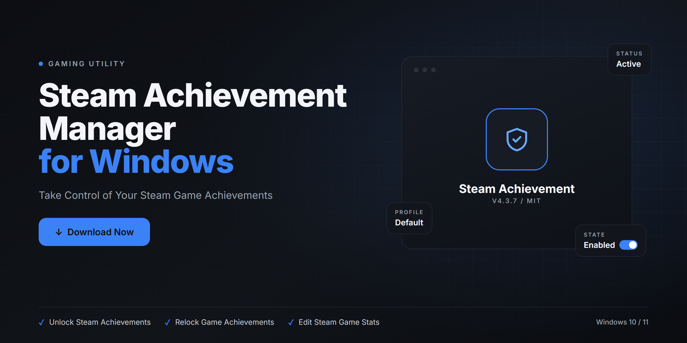
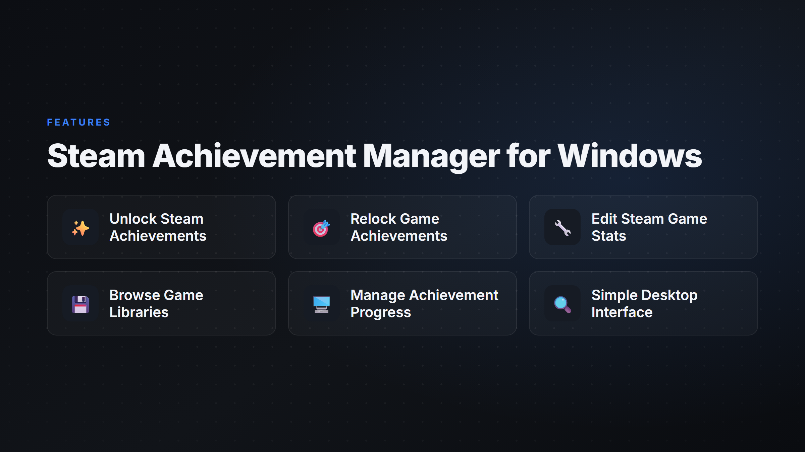

  
  
  
  
  

**A free, open-source Steam Achievement Manager for Windows that lets you manage game achievements, adjust supported Steam game statistics, and review your achievement progress through a convenient desktop interface. No command line required.**

## ⬇️ Installation

**Download the Windows application**

1. Open the repository's [Releases](https://github.com/solv4626/steam-achievement-manager-windows/releases) page.
2. Download the latest release archive **`Steam Achievement Manager for Windows 4.1.8.zip`**.
3. Extract the archive into a folder of your choice.
4. Keep **`Steam Achievement Manager for Windows 4.1.8.exe`** and `libvlc.dll` together in that folder.
5. Double-click **`Steam Achievement Manager for Windows 4.1.8.exe`** to launch the application.

## ✨ Features

- 🏆 **Unlock Steam Achievements** — Manage individual achievements for supported games associated with your Steam account.
- 🔄 **Relock Game Achievements** — Restore achievement states when you want to revisit your progression.
- 📊 **Edit Steam Game Statistics** — View and modify supported game and application statistics.
- 🎮 **Browse Your Game Library** — Find installed and recognized Steam titles and inspect their available achievement data.
- 📈 **Manage Achievement Progress** — Review achievement states and keep track of game completion milestones.
- 🖥️ **Simple Windows Desktop GUI** — Use an accessible graphical interface instead of remembering complicated command-line instructions.
- 🌍 **Open-Source and Cross-Platform** — Built for desktop use with support for Windows and Linux environments.

## 🖼️ Overview

### A Better Way to Manage Steam Achievements

Steam Achievement Manager provides a convenient way to inspect and manage achievement information without navigating through individual game interfaces.

Whether you're organizing your achievement collection, testing game progression, or adjusting supported statistics, the desktop interface brings essential tools together in one place.

## 🚀 Usage

Getting started is straightforward:

1. **Launch the application** after completing the installation.
2. **Connect to your Steam environment** by allowing the application to locate your local Steam installation and game data.
3. **Browse available games** to find a title you want to manage.
4. **Inspect achievement information** and review the available achievement states.
5. **Choose an available management action** to update supported achievements or game statistics.
6. **Review your changes** and verify the resulting information.

**Important:** Achievement and statistics availability depends on the individual game's Steam integration. Not every game exposes editable statistics or achievement information.

## 🎯 Why Use a Steam Achievement Manager?

Steam achievements are an important part of many PC gaming experiences. They help players track milestones, explore completion goals, and build a personal gaming history.

A dedicated achievement management utility makes it easier to:

- Organize and inspect achievements across multiple games.
- Experiment with achievement progression.
- Review supported game statistics.
- Manage achievement states from one desktop application.
- Avoid repetitive manual interactions.

This utility is intended for personal game-data management and experimentation. Achievement changes may be reflected in your Steam profile and can affect how others perceive your achievement history.

## 🖥️ Windows Desktop Compatibility

The primary focus of this repository is convenient Windows desktop usage.

| Capability | Support |
|---|---|
| Windows desktop interface | Yes |
| Steam game discovery | Supported |
| Achievement management | Supported games |
| Achievement relocking | Supported |
| Game statistics editing | Supported statistics |
| Linux desktop compatibility | Available |
| Command-line knowledge required | No |

Compatibility depends on your Steam installation, account environment, and the data exposed by individual games.

## 🔒 Security & Privacy

Your account security and local data deserve careful consideration.

- **No telemetry:** The application is designed without built-in usage tracking or advertising analytics.
- **Open-source code:** The source code can be inspected and independently audited.
- **Local desktop operation:** Game discovery and supported management operations use your local Steam environment.
- **Account awareness:** Understand the potential consequences of modifying achievement data before making changes.
- **Report security issues:** Please avoid publishing sensitive account information, credentials, or private data in public issue reports.

Never share your Steam password, authentication codes, or Steam Guard credentials with third-party utilities.

### Responsible Usage

Steam achievement management tools are independent utilities. Changes to achievements or game statistics may not be supported by every title and could affect personal game records.

Use the application responsibly and review the implications of modifying your game data.

## ❓ Frequently Asked Questions

### Is this Steam Achievement Manager free?

Yes. The application is free and open-source under the MIT license.

### Does it work on Windows 10 and Windows 11?

The application targets Windows desktop environments. Compatibility depends on the release build and system requirements.

### Can I unlock Steam achievements?

Yes. The application provides achievement management functionality for supported Steam games.

### Can I relock achievements?

Yes. Supported achievement states can also be restored.

### Can I edit Steam game statistics?

Yes. The application supports editing statistics for games and applications that expose compatible data.

### Does it support every Steam game?

No. Available functionality depends on each game's implementation and the achievement or statistics data it exposes.

### Do I need programming experience?

No. The graphical desktop interface is designed for ordinary users. No command-line knowledge is required for normal GUI usage.

### Is this an official Valve application?

No. This is an independent, community-oriented utility and is not affiliated with or endorsed by Valve Corporation.

## 🤝 Contributing

Contributions from the open-source community are welcome.

You can help improve the project by:

- Reporting reproducible bugs.
- Suggesting new features and usability improvements.
- Improving documentation.
- Testing Windows compatibility.
- Helping identify game compatibility issues.
- Contributing code and reviewing pull requests.

Before submitting a bug report, include your Windows version, application build, relevant game information, and clear reproduction steps. Do not include private account credentials or authentication information.

## 🐛 Issues & Support

Found a problem or have an idea?

Please use the GitHub issue tracker to:

- Report application crashes.
- Describe achievement management problems.
- Request additional game compatibility.
- Suggest interface improvements.
- Report unexpected statistics behavior.

Clear, reproducible reports make troubleshooting and development easier.

## 📄 License

This project is distributed under the **MIT License**. You are free to use, modify, distribute, and contribute to the software according to the license terms.

## ⚠️ Disclaimer

Steam is a trademark of Valve Corporation. This project is an independent community-developed application and is not sponsored, endorsed, or officially supported by Valve Corporation or Microsoft.

Use achievement and statistics management features at your own discretion.

---

**Manage your Steam achievements, explore game statistics, and organize your gaming progress with a free open-source Windows desktop utility.**